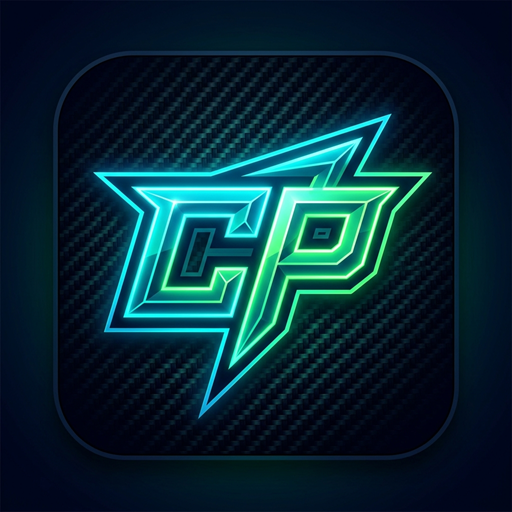

# CPRay Suite 🚀🎮🛡️

<div align="center">
  
  <h3>High-Performance Low-Latency Tunneling & Modern VPN Suite</h3>
  <p>Available on <b>Windows Desktop</b> and <b>Android Mobile</b></p>

  [](https://github.com/ESp3cter/CPRay-Gaming/releases/latest)
  [](https://github.com/ESp3cter/CPRay-Gaming/releases)
  [](https://flutter.dev)
  [](https://sing-box.sagernet.org)
  [](LICENSE)
</div>

---

## 📥 Quick Downloads (Latest Stable)

| Application Flavor | Platform | Description | Download Link |
| :--- | :--- | :--- | :--- |
| **CPRay VPN** | Android (APK) | Ultra-clean **Cloudflare 1.1.1.1 WARP** style 1-tap connection. No gaming menus or clutter. | [📲 Download CPRay-VPN.apk](https://github.com/ESp3cter/CPRay-Gaming/releases/latest/download/CPRay-VPN.apk) |
| **CPRay Gaming** | Android (APK) | Full gamer edition with Per-App Optimizer, 100+ Game Ping Tester, and Adaptive Mobile Drawer. | [📱 Download CPRay-Gaming.apk](https://github.com/ESp3cter/CPRay-Gaming/releases/latest/download/CPRay-Gaming.apk) |
| **CPRay Gaming** | Windows (Installer) | Full Inno Setup installer for Windows 10/11 with bundled Sing-box core & Wintun drivers. | [💻 Download CPRay-Gaming-Setup.exe](https://github.com/ESp3cter/CPRay-Gaming/releases/latest/download/CPRay-Gaming-Setup.exe) |
| **CPRay Gaming** | Windows (Portable) | Standalone portable zero-install `.zip` package. | [📦 Download CPRay-Gaming-Windows-Portable.zip](https://github.com/ESp3cter/CPRay-Gaming/releases/latest/download/CPRay-Gaming-Windows-Portable.zip) |

> [!NOTE]
> All Android APKs are signed with a permanent cryptographic release keystore, ensuring seamless in-app and in-place updates without ever having to uninstall previous versions.

---

## 🎭 Two Specialized Flavors

CPRay provides two distinct application flavors built on top of the same hardened, low-latency Sing-box core engine:

```
                            ┌───────────────────────────────────┐
                            │      Sing-box Core & VpnService   │
                            └─────────────────┬─────────────────┘
                                              │
                      ┌───────────────────────┴───────────────────────┐
                      ▼                                               ▼
     ┌─────────────────────────────────┐             ┌─────────────────────────────────┐
     │           CPRay VPN             │             │          CPRay Gaming           │
     │      (com.cpray.vpn)            │             │       (com.cpray.gaming)        │
     ├─────────────────────────────────┤             ├─────────────────────────────────┤
     │ • Cloudflare WARP 1-Tap Toggle  │             │ • 100+ Game Live Ping Tester    │
     │ • Zero clutter & no gaming tabs │             │ • Per-App Game Booster (5 apps) │
     │ • Floating Bottom Server Drawer │             │ • Mini HUD Mode (Always-on-top) │
     │ • Anti-Sanction Resolvers       │             │ • Wintun Full TUN Routing       │
     │ • Domestic Traffic Bypass       │             │ • Adaptive Mobile Drawer Nav    │
     └─────────────────────────────────┘             └─────────────────────────────────┘
```

### Flavor Feature Comparison

| Capability | CPRay VPN (Minimal) | CPRay Gaming (Gamer Suite) |
| :--- | :---: | :---: |
| **Cloudflare WARP 1-Tap Tactile UI** | ✅ | ❌ |
| **Floating Bottom Server Drawer** | ✅ | ❌ |
| **Per-App Game Booster (Up to 5 apps)** | ❌ | ✅ |
| **Game Ping Tester (100+ Global Games)** | ❌ | ✅ |
| **Mini HUD Overlay Mode (Windows)** | ❌ | ✅ |
| **Anti-Sanction DNS Mode (Radar, Electro, Shecan, DNS4S)** | ✅ | ✅ |
| **Domestic Traffic Bypass (.ir & Local IPs)** | ✅ | ✅ |
| **Auto-Failover / Anti-Disconnect Reconnection** | ✅ | ✅ |
| **In-App 1-Tap Auto-Updater** | ✅ | ✅ |
| **Bilingual Support (English & فارسی)** | ✅ | ✅ |

---

## ✨ Core Highlights

### ⚡ Comprehensive Next-Gen Protocols
Natively powered by Sing-box with hardware-accelerated crypto:
- **VLESS** (Reality / Vision / TLS)
- **Hysteria 2** (High-throughput UDP QUIC tunnel with bandwidth congestion control)
- **TUIC v5** (BBR-accelerated congestion control)
- **VMess** (WebSocket, gRPC, HTTP/2)
- **Trojan** (TLS multiplexing)
- **WireGuard** & **Shadowsocks** (2022 AEAD)

### 🛡️ Anti-Sanction DNS Mode
Bypass regional developer and gaming sanctions with zero tunneling overhead by utilizing specialized low-latency DNS resolvers:
- **Radar Game**
- **Electro Team**
- **Shecan**
- **DNS4S**

### 🎮 Per-App Selective Tunneling (Gaming Flavor)
On Windows, boost up to 5 game executables simultaneously through the low-latency TUN interface while leaving discord, browser downloads, and background system traffic completely direct and unproxied.

### 🔄 Built-in 1-Tap Updates
- **Windows**: Downloads new installer releases in the background and silently upgrades your installation.
- **Android**: Automatically downloads `.apk` updates and opens the system package installer without requiring manual browser navigation or data loss.

---

## 🛠️ Building From Source

### Prerequisites
- [Flutter SDK](https://docs.flutter.dev/get-started/install) (`>= 3.24.0`)
- [Android SDK & NDK](https://developer.android.com/studio) (for Android builds)
- [Visual Studio 2022 with C++ Desktop Workload](https://visualstudio.microsoft.com/) (for Windows builds)
- [Inno Setup 6](https://jrsoftware.org/isdl.php) (for compiling Windows `.exe` setup)

### Clone & Fetch Dependencies
```bash
git clone https://github.com/ESp3cter/CPRay-Gaming.git
cd CPRay-Gaming
flutter pub get
```

### Build CPRay VPN (Minimal Cloudflare WARP Flavor)
```bash
# Android APK
flutter build apk --flavor vpn --target lib/main_vpn.dart --release
```

### Build CPRay Gaming (Gamer Edition Flavor)
```bash
# Android APK
flutter build apk --flavor gaming --target lib/main_gaming.dart --release

# Windows Desktop Application
flutter build windows --release
```

### Compile Windows Setup Installer
```cmd
"C:\Program Files (x86)\Inno Setup 6\ISCC.exe" installer\setup.iss
```

---

## 🤖 Automated CI/CD Pipeline

Every git tag push (e.g. `git tag -a v0.3.8 -m "Release v0.3.8" && git push origin v0.3.8`) automatically triggers the unified GitHub Actions matrix workflow:
1. **Windows Builder (`windows-2022`)**: Compiles Flutter Windows binaries, embeds official Sing-box core, packages portable `.zip`, and builds `CPRay-Gaming-Setup.exe`.
2. **Android Builder (`ubuntu-latest`)**: Compiles both `CPRay-Gaming.apk` and `CPRay-VPN.apk` signed with the locked release keystore.
3. **Release Publisher**: Collects all 4 artifacts into a unified GitHub Release.

---

## 📄 License
This project is open-source and released under the [MIT License](LICENSE).
